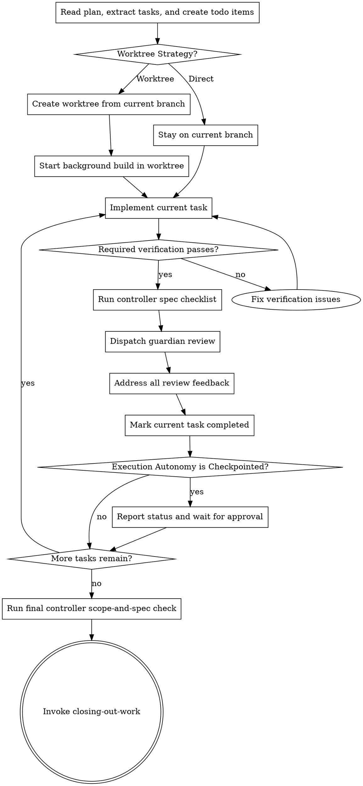

# Executing Plans

## Overview

Load plan, review critically, read the declared `Execution Autonomy`, execute tasks with required verification and review, report when complete.

**Announce at start:** "I'm using the executing-plans skill to implement this plan."

## Checklist

<IMPORTANT>
Create a task for each implementation task from the plan and complete them in order.

todo rules:

1. Create exactly one todo item per plan task.
2. Use the exact `Task N: ...` heading text from the plan as the todo content.
3. Replace any earlier planning checklist items when execution begins.
4. Keep exactly one task `in_progress` at a time.
5. Do not create extra todo items for verification, review gates, or manual checks.
6. Keep the current task `in_progress` until implementation and required verification succeed.
7. If review feedback requires changes, move the same task back to `in_progress` instead of creating a new todo item.
8. Mark the task `completed` only after all required work for that task is finished.
9. In `Checkpointed` mode, wait for user approval only after marking the current task `completed`.
   </IMPORTANT>

## Process Flow



## The Process

### Step 1: Load and Review Plan

1. Read plan file
2. Read the plan's declared `Execution Autonomy` and `Worktree Strategy`
3. Review critically - identify any questions or concerns about the plan
4. If concerns: Raise them with your human partner before starting
5. If no concerns: Create todo items from the exact plan task headings and proceed

### Step 1.5: Set Up Work Environment

Read the plan's declared `Worktree Strategy` and follow it exactly.

#### If `Worktree Strategy: Worktree`

Create a git worktree from the **current branch** to isolate work:

```bash
# 1. Note where you are
CURRENT_BRANCH=$(git branch --show-current)
REPO_ROOT=$(git rev-parse --show-toplevel)

# 2. Check the working tree is clean
git status --porcelain
# If dirty: "Working tree has uncommitted changes. Commit them first (outside this workflow) or abort?"

# 3. Derive the project name from the git root directory name
PROJECT_NAME=$(basename "$REPO_ROOT" | tr '[:upper:]' '[:lower:]' | sed 's/[^a-z0-9]/-/g' | sed 's/--*/-/g; s/^-//; s/-$//')

# 4. Derive a branch name from the plan
#    e.g. plan title "Add Auth Refactor" → branch: "feature-auth-refactor"
#    Sanitize: lowercase, hyphens, no special chars
#    Prepend the project name so worktrees identify their repo at a glance
#    Full result: "bishop-feature-auth-refactor"

# 5. Create the worktree from the current branch
git worktree add ../${PROJECT_NAME}-<branch-name> -b ${PROJECT_NAME}-<branch-name> $CURRENT_BRANCH

# 6. Work from the worktree
cd ../${PROJECT_NAME}-<branch-name>

# 7. Start a background build immediately — saves time on the first verification
#    Detect the build command from project markers (Cargo.toml → cargo build,
#    package.json → npm run build, Makefile → make, go.mod → go build ./...).
#    Run it in the background so implementation can start right away.
cargo build &  # or equivalent for the project — don't wait, move on
```

The agent now works entirely inside the worktree. Tests and file edits happen there.
Git write operations (commit, push, merge) are not performed during execution — they are
gated behind user review at checkpoints (if `Execution Autonomy: Checkpointed`) and at
close-out via closing-out-work.

**If a worktree for this branch already exists**, `cd` into it instead of creating a new one.
Then start the background build (same as step 7 above) so the first verification
isn't waiting on a cold build.

#### If `Worktree Strategy: Direct`

Work directly on the current branch. No worktree setup needed.

#### If the repo can't support worktrees (bare repo, submodule)

Fall back to working on the current branch regardless of the plan's Worktree Strategy.

Before executing tasks, read `Execution Autonomy` from the plan.

- `Fully autonomous`: continue task-to-task unless a stop condition interrupts execution.
- `Checkpointed`: after each completed task, report status and wait for user approval before continuing.

In both autonomy modes, a task is complete after its required verification passes and all review feedback has been addressed.

For each task:

1. Mark the matching todo item as `in_progress`
2. Call `task_snapshot(action: "start", taskId: <id>)` — captures the working-tree baseline before any changes are made
3. Follow each step exactly (plan has bite-sized steps)
4. Run verifications as specified
5. Once verification passes, call `task_snapshot(action: "end", taskId: <id>)` then call `task_snapshot(action: "diff", taskId: <id>)` and capture the output as `DIFF`
6. Run the controller-owned spec check defined in `know-how:requesting-code-review` against the task requirements, `DIFF`, and the plan's Testing Approach. If any answer is unclear or no, stop and resolve that before review.
7. Dispatch the `guardian` agent (using `guardian-prompt.md`) for code-quality and convention review, passing `DIFF` as the literal diff text in the task string.
8. Address every guardian finding.
9. Re-run the task's required verification after fixes to confirm nothing broke.
10. Mark the same todo item as `completed`
11. If `Execution Autonomy` is `Checkpointed`, report status and wait for user approval before starting the next task

### Step 3: Complete Development

After all tasks complete and verified:

- Run a final controller scope-and-spec checklist against the plan and the full working-tree diff.
- Re-run verification after any final fixes.
- Announce: "All implementation tasks complete. Executing close-out task."
- The plan's close-out task handles verification, cleanup, and integration.

## When to Stop and Ask for Help

**STOP executing immediately when:**

- Hit a blocker (missing dependency, test fails, instruction unclear)
- Plan has critical gaps preventing starting
- You don't understand an instruction
- Verification fails repeatedly
- Required context is missing
- The user interrupts or redirects the work

**Ask for clarification rather than guessing.**

## When to Revisit Earlier Steps

**Return to Review (Step 1) when:**

- Partner updates the plan based on your feedback
- Fundamental approach needs rethinking

**Don't force through blockers** - stop and ask.

## Remember

- Review plan critically first
- Read and follow the plan's `Execution Autonomy` exactly
- Read and follow the plan's `Worktree Strategy` exactly
- Create todo items from the exact plan task headings only
- Follow plan steps exactly
- Follow the plan's `Testing Approach` exactly
- Don't skip verifications
- Don't create extra todo items for verification, review gates, or manual checks
- Don't mark a task complete before the controller spec checklist passes and all guardian feedback is addressed
- Always run the controller spec checklist before guardian review after verification
- Always re-run verification after any guardian-driven fixes
- Don't skip the final controller scope-and-spec check before the close-out task
- Reference skills when plan says to
- Stop when blocked, don't guess
- Never start implementation on main/master branch without explicit user consent
- Never make git write operations during execution: no commits, pushes, merges, stash, checkout --, branch -D, or worktree remove during task execution. All git integration is gated behind user review at checkpoints and at close-out via closing-out-work
- Never treat worktree branches as "safe to commit on". The git write gate applies universally, regardless of branch
- Use the current workspace unless the user explicitly asks for a different setup

## Integration

**Required workflow skills:**

- **know-how:writing-plans** - Creates the plan this skill executes
- **know-how:requesting-code-review** - Use for focused review on risky, behavior-changing, or multi-file tasks
- **know-how:closing-out-work** - Close out work after all tasks, get user review, then choose integration (invoked by the plan's close-out task)
- **guardian-prompt.md** - Dispatch template for code-quality review (in same directory)
